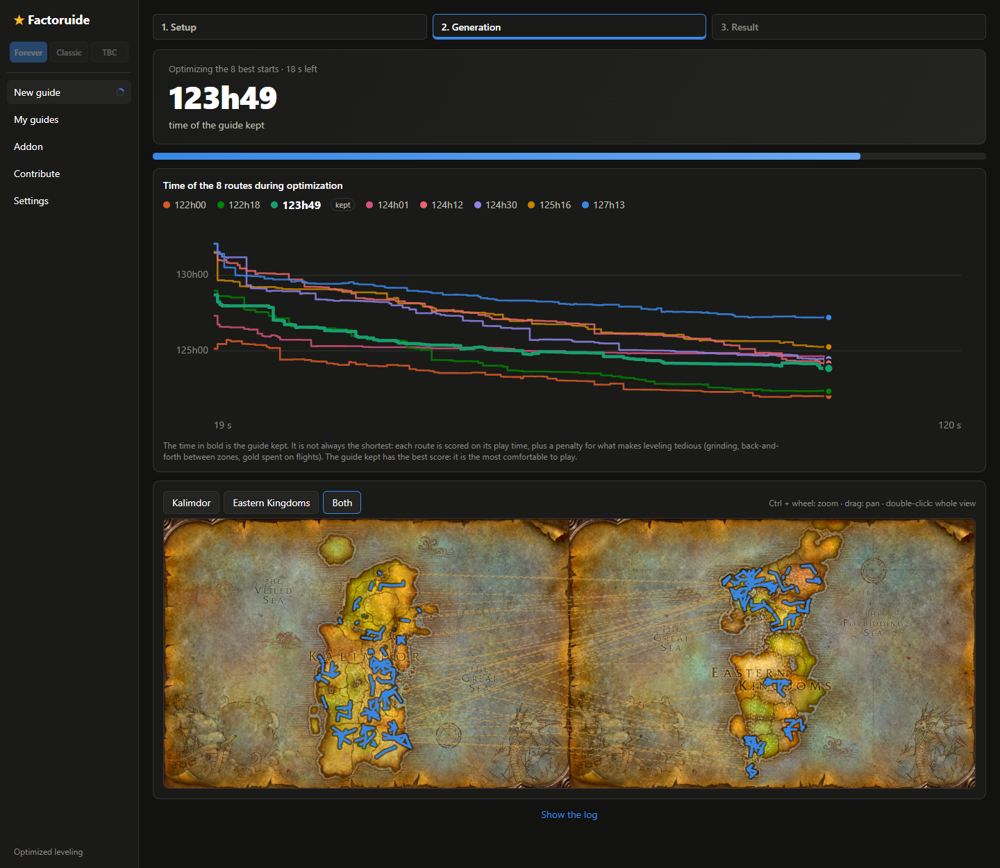

# Factoruide

**A leveling guide built for you**: your character, your professions, your zones, your dungeons
and the way you play. For **WoW Forever**, **Classic Era / Hardcore** and **TBC Anniversary**.

Leveling guides follow one route written for everyone. Factoruide computes yours: it simulates
the whole playthrough with your choices (travel, fights, drops, quest and mob XP, trainers,
professions, and how strong your character gets with its gear and spells) and searches for the
fastest route to your target level, killing the mobs met on the way and grinding only a small
share of each level. The in-game addon then takes you through it step by step.


## An experiment

Factoruide is experimental. A guide comes from a simulation of the game, and the simulation is
not the game: it can produce inconsistencies (a quest you cannot get, a detour that makes no
sense, a time far from yours). When you meet one, please
[open an issue](https://github.com/brouznouf/factoruide/issues) with your guide attached: the
"Share" button of its page saves it as a `.fgguide` file.

It will never replace the guides written by hand, and that is not the goal: their authors play
their route again and again, and a good one will most likely be faster. Factoruide builds a
guide of your own that holds together as a whole and gives your leveling real directions: which
zones to do, the level to reach before moving on from each, and where the XP is.

## A guide that fits you

- **Your character**: race, class and level range: start a guide at level 1, or from your
  character as it is in game. The addon records it at each logout (or at once with
  `/fg profile`): pick it in the list of the new guide and the guide goes on from where it
  stands: its quests done are left out, those in its log are taken again when they help (as if
  never taken) and abandoned as the first step otherwise, from its position, with its
  hearthstone, flight paths, rested XP, gear, spells and professions.
- **Your professions**: two primary professions and the secondary ones, with the skill to have
  at each level from the level you take them (curves from classic guides, editable). They add no
  time to the route: the addon shows whether you are ahead or behind, and their quests are
  suggested as optional steps.
- **Your zones**: click the map to prefer the zones you like and exclude the ones you don't want
  to see again.
- **Your dungeons**: force or exclude each dungeon, do the worthwhile ones in a group, take their
  quests a few levels ahead.
- **Your class quests**: the ones you want to do are kept, even when they are not the fastest.
- **Your play style**: a relaxed, normal or fast pace (time per fight, per loot, per stop), how far
  above your level you take quests and fight mobs, how much grinding you accept, flights or
  walking to save gold, finishing a zone before leaving, staying on one continent, elite quests
  solo or in a group, how crowded the server is (escorts, events and small spots fought over).
- **Your group**: level in a duo or a group with other classes: faster fights, shared XP with the
  group bonus, quest items for everyone, each class's quests and trainers.
- **Your language**: the app and the guide in 10 languages. A guide is computed once and shown in
  the app's language; the addon writes it in the language you choose on its page.


## It adapts as you play

- The addon follows you: it advances by itself (quest accepted, objective done, quest turned in,
  flight, level reached), points the compass at the next step and compares your real time per level
  with the guide's (`/fg time`).
- Ahead, behind, changed your mind about a profession or a zone? Generate the guide again from your
  character as it is now: it becomes a new version of the guide, with the difference from the previous
  one, and you choose the version its characters follow.
- The guides learn from the game: the XP and positions the addon records replace the estimates,
  and the "Contribute" page sends what your game sees to the Factoruide server (anonymous, only what
  is new, automatically if you turn it on) and lists the other tools that feed the community's quest
  databases.
- Rework a guide by hand: move, remove or add steps (a quest, the hearthstone, a flight, mobs to
  kill), the guide replayed after each change with its new time and the steps that are no longer
  possible; saved as a new version once every step holds.
- Share a guide with a friend as a `.fgguide` file; they import it in their app.


## Getting started

1. Download the app from the [latest release](https://github.com/brouznouf/factoruide/releases/latest)
   and install it. New versions are then offered by the app at startup.
   - **Windows**: run the `_x64-setup.exe` installer. Windows may warn about an unknown publisher
     the first time (the installer is not code-signed).
   - **macOS**: open the `_aarch64.dmg` (Apple Silicon) or `_x64.dmg` (Intel) and drag the app to
     Applications. The app is not notarized by Apple, so macOS refuses to open it the first time:
     go to System Settings > Privacy & Security and click "Open Anyway", or run
     `xattr -dr com.apple.quarantine /Applications/Factoruide.app`. Updates do not ask again.
2. **Settings**: choose your WoW folder.
3. **New guide**: pick your character, professions, zones, dungeons and play style, then start
   the generation (about 2 minutes, 6 for a thorough one, depending on the processor). The best
   starting routes are picked first, then improved in rounds where the better half goes on: their
   times go down live on the chart and the route is drawn on the map. The
   guide kept (in bold) is the best balance between play time and comfort (little grinding, few
   trips between zones), not always the very shortest.

   
4. **Characters**: choose the guide each character follows (a guide started from a character
   follows it already), then `/reload` in game. A character follows only the guide chosen for it.

### Checking for app updates

Open **Settings** and select **Check for updates**, or on macOS choose
**Factoruide → Check for Updates…** from the menu bar. If a release is available,
review its notes, select **Update**, and confirm the restart. The app downloads
and verifies the publisher's update package before installation. Failed checks
and installs show an error and can be retried. If the app cannot restart after
installation, select **Restart Factoruide**; it does not download the update again.

Published builds also check at startup. Local builds check only on request and
warn before being replaced by an official release. Wait for guide generation to
finish before installing; unsaved guide edits require confirmation.

### Building on macOS

Install Xcode Command Line Tools (`xcode-select --install`, or use a full Xcode
installation), Node.js 22 and npm, and Rust via [rustup](https://rustup.rs/).
The repository's `rust-toolchain.toml` selects the Rust version. Then, from a clone:

```sh
./scripts/build-macos.sh
open target/release/bundle/macos/Factoruide.app
```

The script installs the locked frontend dependencies, builds a native app for the
Mac running the build, and applies and verifies a local ad-hoc signature. No Apple
developer certificate or publisher updater key is needed. You can copy the app to
Applications. This is a local build, not an Apple-notarized distribution, and it
does not check for updates automatically; you can check manually in Settings.

The app defaults to `/Applications/World of Warcraft`; choose another installation
in the **Addon** page if needed. Follow the addon and guide steps above. After
first installing the addon, restart WoW so it discovers the new files.

Verified on Apple Silicon with WoW Forever: native app launch, character profile
import, guide generation and user-reported in-game use. Intel Macs have not been
verified.

## In game: the addon

The addon comes in two parts: **Factoruide_Profile** records your character and what the game
shows (profile, collector below), **Factoruide_Guide** shows the guide and everything around it.
On WoW Forever, the **Addon** page can have [Polestar](https://github.com/fitzforge/polestar) show
your guides instead: the app then installs them as a Polestar guide pack (Factoruide_Polestar),
leaves the guide part out, and the profile part keeps recording. In Polestar, choose Factoruide
under "Suggest guides from" on the "Guide packs" page: it offers each character the guide of its
race and class.

- Guide: follows the guide chosen for the character in the app and advances by itself; `/fg guide`,
  `/fg next`, `/fg prev`, `/fg step <n>`, `/fg route` (shows it), `/fg waypoint`. Two modes: full
  (a card with the current tasks, the next steps and the talent to learn) or minimal (a strip at
  the top of the screen, the next steps on mouse-over); `/fg mode` or a key binding switches.
  Mobs living in several places: the compass moves on to another place when nothing is found at
  one (`/fg spot` at once), and the world map shows them all.
- Size: Ctrl + mouse wheel over a window, or `/fg scale <size>`.
- Helpers: a compass bar at the top of the screen with the step to go to, the other current
  tasks, the quests to pick up close by and the next turn-in (mouse over: what and how far;
  click: go there), targeting macro "FG Cible" (`/fg macro`), quest item button (key binding in the game's
  key bindings, Factoruide section), the step's flight taken automatically, next steps numbered on
  the world map.
- Vendors: sells gray items, repairs, buys food, water and ammunition for your level (disabled by
  default; hold Shift when opening to skip everything).
- Gear and talents: the quest reward the guide planned (the route counts on wearing it), upgrades
  in tooltips and on quest rewards, the recommended talent in the guide. At the class trainer,
  only the spells that matter for leveling are bought.
- Quest panel: one line per quest in the guide's order, tabs for the guide's professions and
  reputation goals, and the items to keep for its quests (cloth, meat…) with how many are in the
  bags and the bank (read at each visit; at the bank it says what to take and what can stay).
- Group and safety: party members' progress in the quest panel, alerts on elite or high-level
  targets and low health, elite objectives flagged in the guide.
- Profile: what the app needs to start a guide from your character (level, XP, quests done and in
  the log, position, hearthstone, flight paths seen on flight maps, professions, gear, spells),
  kept up to date every minute and at logout; `/fg profile` writes it to disk now (the interface
  reloads).
- Collector: records what you see (givers, positions, XP received) for the next guides;
  `/fg status`, `/fg debug`, `/fg reset`.

## How it works

How the optimized route is computed: [ARCHITECTURE.md](ARCHITECTURE.md).

## License

The code is under the MIT license ([LICENSE](LICENSE)). The quest databases (`data/`) are under
GPL-2.0-or-later, the license of the VMaNGOS data they include ([data/LICENSE](data/LICENSE));
their sources and the terms of each are listed in [NOTICE.md](NOTICE.md).
